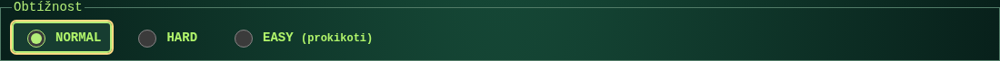
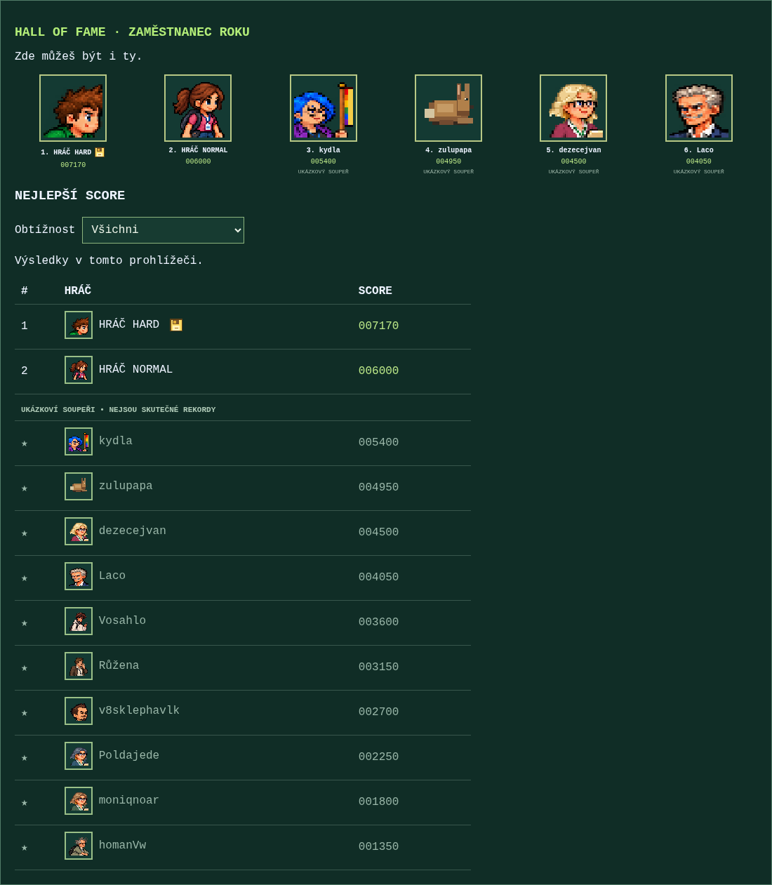
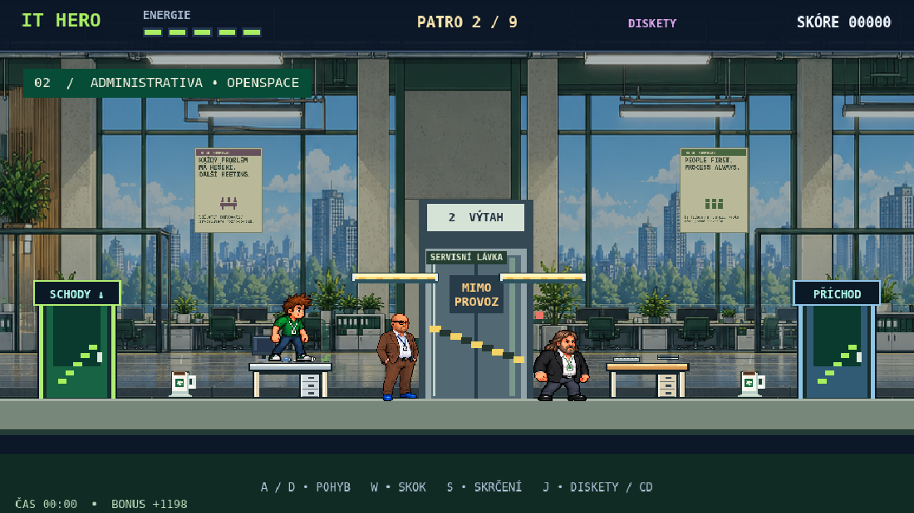

# Easy / Normal / Hard – 0.28.0

Po novém otevření stránky je zvolený **Normal** a **Ajťák**. Volba obtížnosti se při startu kampaně uzamkne; restart z checkpointu ji zachová.

| Režim | Rychlost nepřátel a střel | Interval útoků | Ochrana po zásahu | Zdraví na startu | Rekordy |
| --- | --- | --- | --- | --- | --- |
| Easy | 75 % | ×1,30 | 2 s | 5 | Ne |
| Normal | 85 % | ×1,25 | 1,75 s | 5 | Ano |
| Hard | 100 % | ×1,00 | 1,25 s | 4 | Ano, zlatá disketa |

Normal navíc ubírá jeden zásah protivníkům s více než třemi životy. Hard zachovává původní herní pravidla. Easy má původní průběžné checkpointy i vlastní obrazovku po závěrečné animaci a bez zápisu skóre.

## Rekordy a bezpečný přechod

Skóre obou bodovaných režimů je společné; pořadí stále určuje počet bodů. Přepínač Všichni / Normal / Hard je na hlavní stránce i v místní výsledkové tabulce. Zlatá disketa je kreslená pixelová ikona s přístupným popisem; ukázkoví soupeři ji nedostávají.

Migrace `0007_difficulty_modes.sql` přidává pouze tabulky metadat, nemaže ani nemění jména, avatary, body, časy či statistiky. Dosavadní výsledky označí jako Hard, protože předchozí server přijímal výhradně tehdejší Normal a nikoli Easy. Opakované spuštění nepřeznačí nové rekordy. Stejně se označí staré místní výsledky bez pole difficulty.

Nový klient posílá `rulesVersion:2`; starý klient bez této verze je nadále správně hodnocen jako Hard. API výsledek Easy nepřijme. ID požadavku nelze opakovat s jinou obtížností. Místní archiv uchovává až 100 výsledků, výpis zůstává TOP 10, aby šlo smysluplně filtrovat oba režimy.

Tabulka starých herních spuštění má původní omezení normal/easy. Pro zpětnou kompatibilitu zapisuje Hard do této historické kolony jako normal a skutečný režim ukládá do nové tabulky `arcade_run_modes`. Počty spuštění se nemění. Vynulování ze správy čistí i nové tabulky metadat. Nebyl požadován ani proveden reset produkčních výsledků.

Veřejný deploy aplikuje idempotentní migrace před nahráním nové verze Pages. Původní komunitní Worker se aktualizuje přes existující deploy workflow.

## Plošiny

Servisní lávky mají světle zlatou horní plochu, tmavý obrys, světlé konce a tmavě modrou spodní lištu s barevnými prvky. Nezměnila se jejich výška, šířka, poloha ani jednosměrné kolize; horní viditelná hrana sedí na `body.top`. Ověřen skutečný výskok ze stolu, dopad i seskok skrčením ve druhém patře.

## Kontrola Ajťáka

Klávesový test za pohybu potvrzuje střídání `hero-walk` a `hero-motion-walk-alt`. Těleso a pohyb jsou funkční. Při současné střelbě ale bylo **16 z 20 pohybových snímků ve statické póze `hero-motion-attack`**. Běžné kroky jsou jen dva, jeden z nich procedurální.

Návrh další opravy: stejný postup jako u Ajťačky – čtyři jasné fáze kroku, společné měřítko a střelecké pózy zachovávající pohyb nohou. Grafika Ajťáka v tomto vydání úmyslně neměněna; uživatel požádal o kontrolu a případný návrh.

## Ověření

- `tests/difficulty-modes.mjs`: skutečná SQLite migrace dvakrát, zachování starých bodů, staré/nové klienty, Normal/Hard zápisy v prohlížeči i filtry/ikony, Easy bez formuláře, nové režimy spuštění, idempotence a konflikty, výchozí volby i po reloadu, rychlosti 85/100/75 %, zdraví a ochrana, mobil, čistění nových metadat při správcovském resetu.
- `tests/shared-scores.mjs`: řazení, TOP 10, avatary, validace, idempotence a limity.
- `tests/difficulty.cjs`: původní Easy včetně závěrečné animace a návratu k Normalu.
- `tests/dbpm.cjs`: původní Byznysák na Hardu, přeskakování stolů, útoky a životy.
- `tests/stairs-platforms.cjs`: reálné schody, lávky a seskoky.
- `tests/public-copy.mjs`: veřejný balíček, hra/galerie, API, moderace.
- `tests/admin-reset.mjs`: reset metadat, uchování komentářů, mobilní ovládání.
- `tests/deploy-community.mjs`: příprava migrací a nasazení s testovacím API.

## Náhledy

Aktualizace 0.28.1: uživatel následně schválil návrh Ajťákovy chůze a oprava byla zapracována; podrobnosti viz [boy-walk.md](../boy-walk.md).
