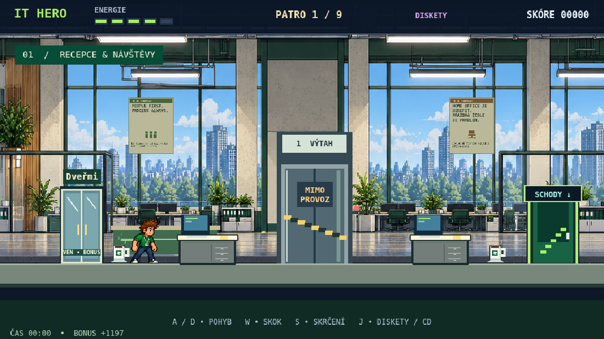
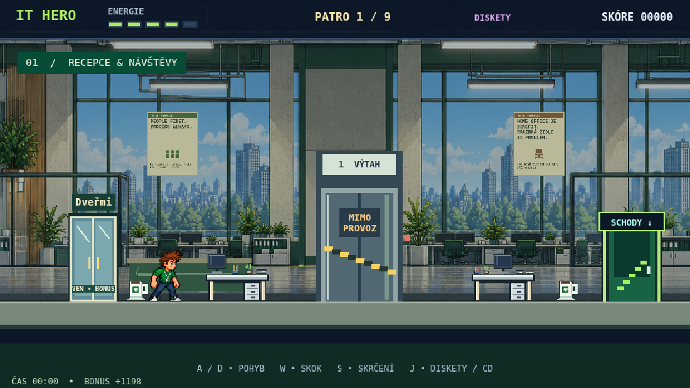
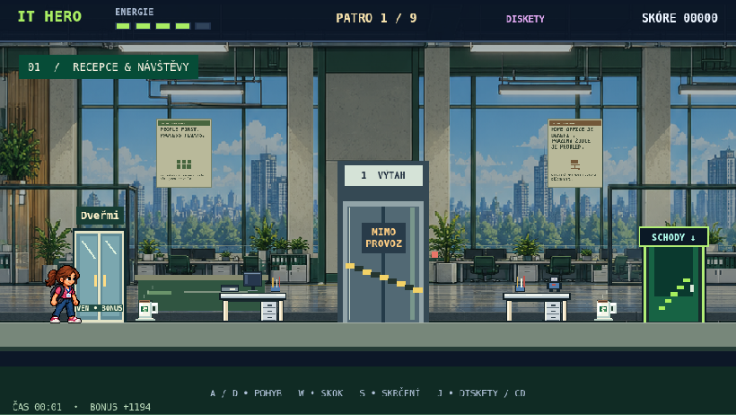

# Kancelářské stoly – návrh k revizi

Větev `feature/office-desks-redesign`. Návrh není určen k automatickému sloučení ani nasazení.

## Grafika a fyzika

Schválená varianta **C**: krémové kovové nohy široké 5 pixelů se světlou hranou, výraznější medová deska a světlé zásuvky dřevěné varianty. Pozadí všech devíti kanceláří je utlumené vrstvou s průhledností 0,36; dveře, postavy, stoly ani rozhraní nejsou touto vrstvou ovlivněny.

Dva sdílené typy: medově dřevěný (výchozí pro odbory, management a vedení) a světlý moderní (zejména recepce a HR). Oba mají tmavý obrys, světlou silnou desku, stín, kovové nohy a zásuvkový kontejner. Boční perspektiva, průhledné pozadí, ostré pixely.

Původních 18 pevných těles na devíti patrech zůstává širokých 88 a vysokých 38 herních pixelů na stejných souřadnicích. Původní deska přesahovala těleso do stran a ležela 8,5 pixelu nad ním. Nový vrchol textury je přesně `ground - 38`, shodný s `body.top`; šířka textury odpovídá kolizi. Nemění se rychlosti, skok ani algoritmus překonávání překážek Byznysáka.

Hloubka stolů 10, dekorací 12: za hráčem a nepřáteli, před pozadím. Předměty nemají fyzikální tělesa. Deska má nepřerušenou světlou čelní hranu pod předměty.

## Dekorace

25 položek: monitor, otevřený notebook, zavřený notebook, klávesnice, myš, hrnek, papíry, hromádka složek, pořadače, psací potřeby, stolní telefon, mobil, lampička, rostlina, kaktus, jablko, banán, láhev vody, svačinový box, model auta, dinosaurus, robot, maskovaná figurka, ovladač, vesmírná loď. Figurky jsou původní siluety bez log.

V každém patře má alespoň jeden náhodně zvolený stůl monitor v plné šířce 28 herních pixelů, pro který je rezervován samostatný širší slot. Každý stůl má 2–5 různých položek; monitor a otevřený notebook se nevyskytují společně. Předměty jsou vybírány bez opakování, mají oddělené sloty a během hry se nepřeskupují. Menší stůl s více předměty používá přiměřeně zmenšené dekorace.

## Konfigurace a rozšíření

`office-desks.js` obsahuje:

- `palettes`: barvy desky, její čelní hrany, kresby a zásuvek pro oba typy.
- `structure`: barva kovových nohou, světlé hrany a šířka nohou.
- `background`: barva, průhlednost a hloubka vrstvy tlumící kanceláře; `shadeBackdrop(scene, ground, width)` ji vytvoří za herními objekty.
- `themes`: devět řádků v pořadí skutečných pater. `wood` je pravděpodobnost dřevěné varianty 0–1; `favorites` jsou preferované položky. Preferovaná skupina se při každém výběru použije s pravděpodobností 0,72, je-li dostupná. Zbývající výběr čerpá ze všech zbývajících položek.
- `dimensions`, `depth`: výchozí rozměry a vrstvy. Rozměry neměnit bez opětovného fyzikálního ověření.
- `preload(scene)`: načte 27 samostatných průhledných PNG z `assets/office-desks/`.
- `createDeskTextures(scene)`: generuje chybějící textury jako zálohu; existující klíče nepřepisuje.
- `createDesk(scene, {x, ground, floor, type, width, height, decorations, random})`: jeden pevný stůl.
- `generateDeskDecorations(scene, desk, config)`: čistě vizuální předměty. Explicitní `decorations` musí mít 2–5 platných ID.
- `placeDesks(scene, floorPlans, floors, {seed, random})`: zachovává polohy z `FLOOR_PLANS`.

Pro opakovatelné rozložení nastavte před vytvořením scény `scene.registry.set('officeDeskSeed', 'demo-1')`. Běžný start používá nové náhodné rozložení; žádná náhodnost neběží v `update()`.

Další předmět: přidat ID do `items` i cestu PNG do `textureSources`, nakreslit jeho samostatnou texturu v příslušné větvi `switch` (28×30 px, spodní hrana na y=30) a případně přidat ID do `themes[].favorites`. Zachovat průhledné okolí. Obrázek lze nahradit přímo v `assets/office-desks/office-item-ID.png`; při přidání nového ID je nutné dodat i jeho PNG. Generátor existující texturu zachová. Stoly používají `office-desk-wood` a `office-desk-modern` (88×38 px); i náhradní textura musí mít pracovní plochu na horním řádku a půdorys po celé šířce.

Po úpravě kreslicího kódu vygenerujte PNG příkazem `node scripts/export_office_desks.cjs` při běžícím místním serveru na portu 8000. Při ruční výměně PNG tento příkaz nepouštějte, přepsal by je původní kresbou.

Textury se sdílejí napříč všemi patry a restarty. Celkem 27 klíčů. Jeden statický fyzikální objekt na stůl, 2–5 nefyziálních obrázků navíc, žádné další závislosti.

## Ověření a screenshoty

`node tests/office-desks.cjs`: skutečné klávesové skoky z podlahy a seskoky ze všech 18 stolů s oběma hrdiny, geometrie viditelných desek i chodidel, všechny podlaží, seed, restart, počet textur, vrstvy, nepřítomnost kolizí dekorací a mobilní zobrazení. Izolovaný test vypíná protivníky; samostatný `node tests/dbpm.cjs` ověřuje skutečného Byznysáka, přeskakování stolů, útoky i překážky DEMAND.

Srovnání zachycuje stejnou scénu, stejného hrdinu na stejném místě, stejný viewport a výřez skutečného herního plátna. Nejde o zvětšené grafické návrhy. Další snímky všech devíti pater a mobilu ukládá test do `/tmp/it-hero-tests/office-desks/`.

| Před | Po |
| --- | --- |
|  |  |

### Výsledky ověření této větve

- `node tests/office-desks.cjs`: PASS, všech 36 skutečných skoků a seskoků, geometrie i viditelná chodidla, devět pater, obě varianty, různorodé dekorace, seed/restart, mobilní rozměr 844×390, žádné chyby JavaScriptu. Kontroluje také světlé nohy v načtených PNG a devět vrstev utlumeného pozadí.
- `node tests/dbpm.cjs`: PASS, překonávání obou stolů v obou směrech, útoky na blízko/na dálku, DEMAND, životní cyklus a úklid kolizí.
- `node tests/trio-collisions.cjs`: PASS, skutečné zásahy Security mastera, HR a design manažera disketou/CD, porážka a skóre.
- `node tests/public-copy.mjs`: PASS, všech 27 PNG zahrnuto, hra i galerie funkční v sestavené veřejné kopii; žádné externí požadavky, funkční API a moderace.
- Výkon: stejný headless Chromium, viewport 844×390, stejné místo, vypnutí nepřátelé a návštěvy, zahřátí 1 s a 120 snímků. Původní verze: medián 49,9 ms, p95 66,6 ms. Schválená varianta C: medián 50,0 ms, p95 66,7 ms. V tomto prostředí není patrný rozdíl; nejde o měření na skutečném telefonu a výkon závisí na zařízení.
- `git diff --check` a syntaktická kontrola JS: PASS.

### Změněné soubory

`game.js` (integrace místo původních obdélníků), `index.html` (nový modul a cache), `character-preview.html` (shodná verze cache), `office-desks.js` (nový modul), `assets/office-desks/*.png` (27 textur), `scripts/export_office_desks.cjs` (export PNG), `tests/office-desks.cjs` (nový fyzikální test), `tests/public-copy.mjs` (kontrola balení textur), `docs/office-desks/` (dokumentace a screenshoty).
