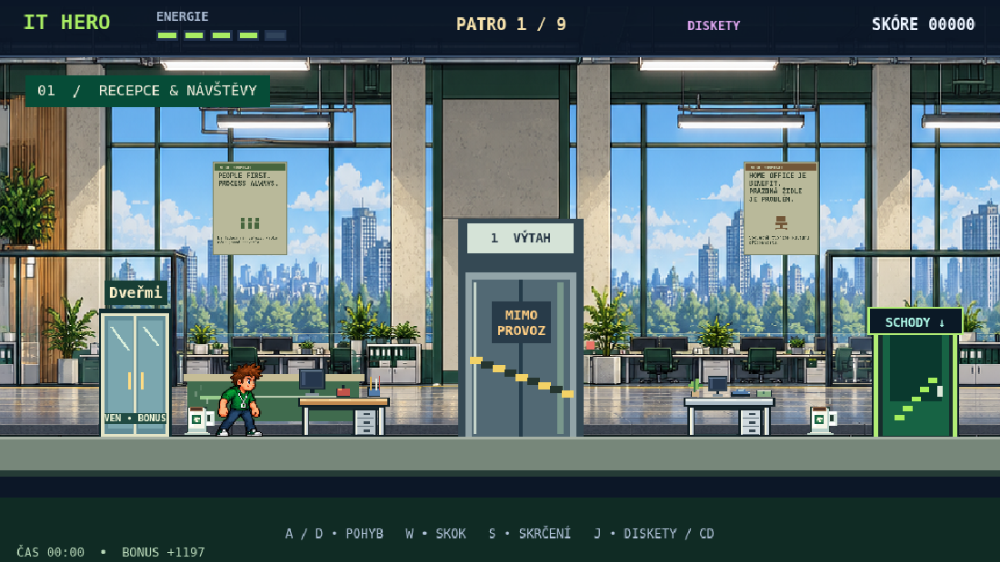
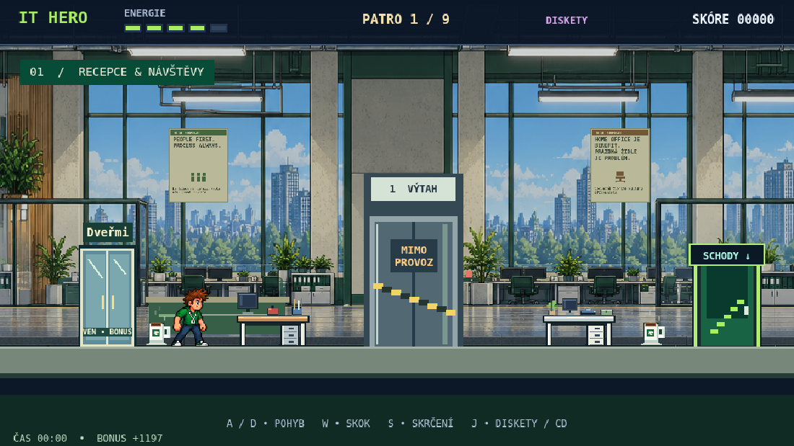
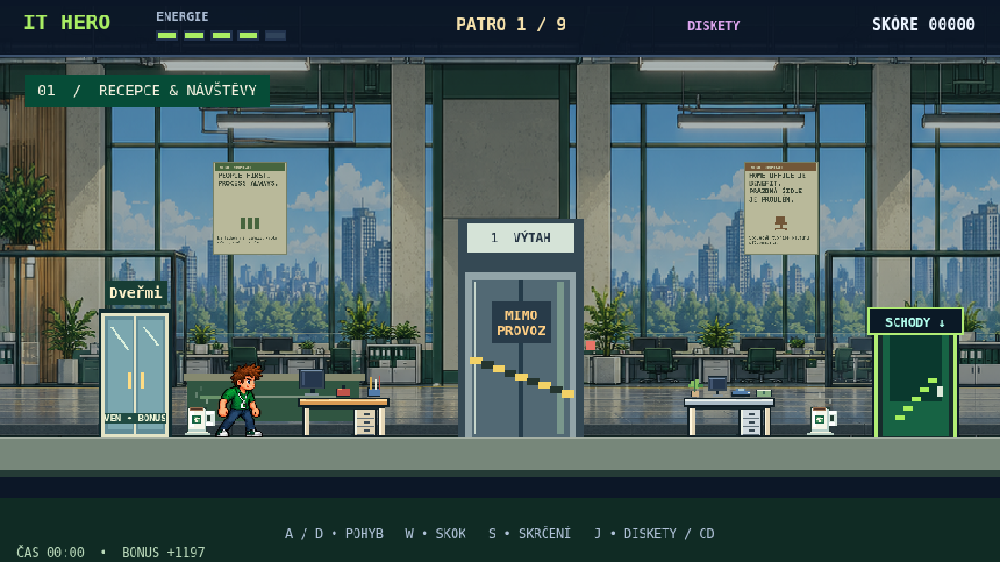

# Varianty pro porovnání čitelnosti

Pouze návrhy k výběru, nikoli vybraná výsledná úprava hry. Snímky skutečného Phaseru, stejný seed dekorací, místo hráče a viewport. Vlevo dřevěná, vpravo moderní varianta.

- A: širší hliníkové nohy se světlou hranou; původní pozadí.
- B: bílé nohy a světlejší zásuvky moderního stolu; pozadí kanceláře utlumeno o 20 %.
- C: širší krémové nohy, výraznější medová deska a světlé zásuvky; pozadí utlumeno o 36 %.

Ztmavení se týká pouze vrstvy kanceláře, nikoli hráčů, herních stolů, dveří či rozhraní. Žádné změny fyziky. Doporučená varianta C nejvýrazněji odděluje herní překážky od zadního vybavení.

Reprodukce: běžící místní server, `IT_HERO_PREVIEW_URL=http://127.0.0.1:8001 node scripts/office_desk_proposals.cjs`. Skript provádí pouze dočasné změny ve svém prohlížeči, nemění PNG ani runtime modulu hry.
