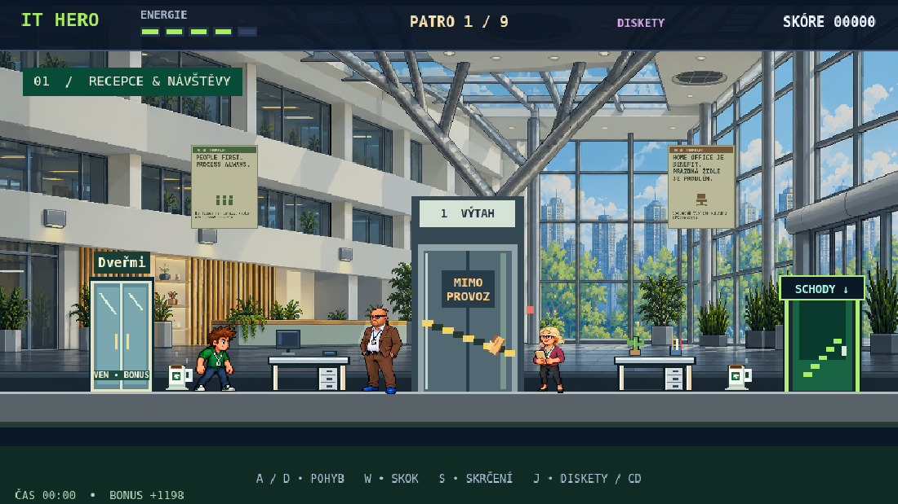
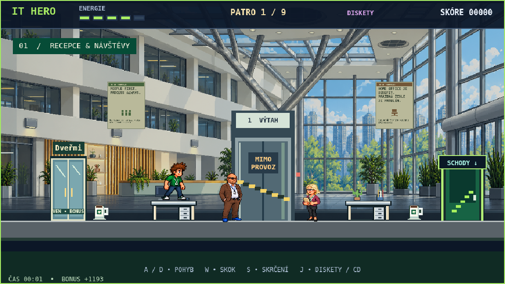
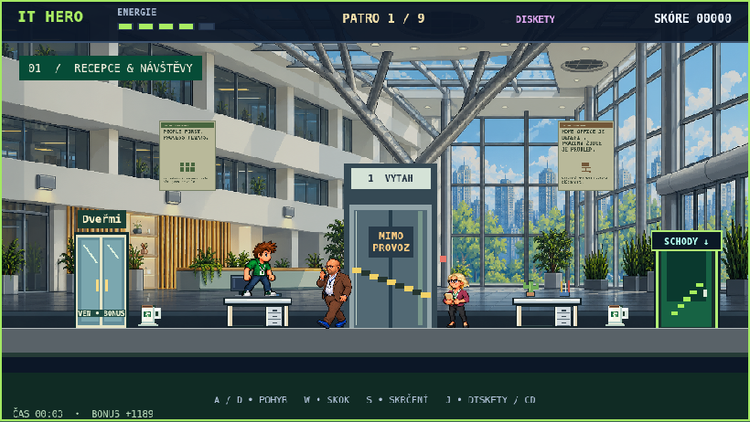

# Návrh recepce podle fotografie

Architektonický návrh pro přízemí, připravený na větvi `design/reception-photo`. Nejde o nasazení ani o změnu veřejné verze hry.

Vychází z dodané fotografie atria: bílé galerie s tmavými kancelářskými okny, vysoká skleněná stěna a světlík, větvené ocelové vzpěry, kruhové stropní prvky, recepční pult s medovými svislými lamelami, tmavě šedá dlažba a velké rostliny. Fotografie je reinterpretovaná jako pixel-art pozadí se zcela vodorovnou herní podlahou. Její původní snímek není do repozitáře kopírován.

Hratelnost zachována:

- Dveřmi ven vlevo na x=130, výtah uprostřed a schody vpravo zůstávají stávajícími herními objekty.
- Oba pevné stoly přízemí zůstávají na x=330 a x=700, se stejnými tělesy a monitory.
- Podlaha, rozměry hrdiny, protivníci, sbírání kávy/CD a ostatní patra se nemění.
- Recepční pult, zeleň a ocelové vzpěry jsou pouze pozadí, nikoli nové překážky.
- Nové pozadí používá jemnější útlum 16 %, aby zůstalo vzdušné; současné přední stoly a postavy jsou plně kontrastní.

Soubory:

- `reception-background.png`: nově vytvořená pozadí podle fotografie, bez postav a herních objektů.
- `before.png` / `after.png`: stejný seed dekorací, stejné herní měřítko a poloha hráče.
- `jump.png`: skutečný dopad hrdiny na první stůl v navržené scéně.
- `mobile.png`: pohled při viewportu 844×390.
- `scripts/reception_photo_preview.cjs`: reprodukovatelný lokální náhled. Úpravy aplikuje pouze v prohlížeči; produkční `game.js` ani HTML nepřepisuje.

Spuštění při místním serveru: `IT_HERO_PREVIEW_URL=http://127.0.0.1:8005 node scripts/reception_photo_preview.cjs`.

Ověření proběhlo v Chromiu: původní a navržená scéna mají totožné polohy a rozměry všech pevných stolů, plošin, dveří i tělesa hrdiny a stejný počet protivníků. V obou variantách prošel skutečný klávesový skok a dopad na první stůl. Žádné chyby JavaScriptu.

