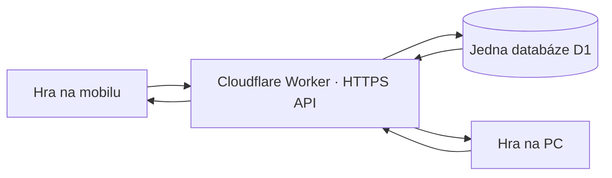

# Jeden společný žebříček IT HERO

**Stav: konkrétní návrh, zatím nenasazený.** Aktuální hra 0.16.1 stále ukládá
skutečné výsledky lokálně. Ukázková jména se do úložiště nikdy nezapisují.

## Doporučené řešení: Cloudflare Worker + D1

Hra zůstane na stávajícím GitHub Pages. Přibude jedna malá služba (Worker)
s jednou SQL databází D1. Mobil, PC, Android, iPhone i různé prohlížeče budou
používat stejné HTTPS API. Databáze bude jediným zdrojem veřejných výsledků.
GitHub Pages sám databázi ani serverový zápis nepodporuje.
Pro začátek malé hry je vhodný bezplatný plán Cloudflare; služba podléhá jeho
limitům. Není potřeba stěhovat hru ani přidávat hráčům přihlášení.

## Co hráč uvidí

1. Po vítězství zadá jméno stejně jako nyní. Vybere ZAPSAT SKÓRE.
2. Hra odešle výsledek, služba potvrdí přijetí a vrátí pořadí i aktuální top 10.
3. Tabulka má přepínač SVĚT / TOTO ZAŘÍZENÍ; hlavní je SVĚT, označený datem
   posledního úspěšného načtení. Při otevření se znovu načte, neukazuje jen cache.
4. Bez internetu lze hrát dál. Výsledek má stav ČEKÁ NA ODESLÁNÍ, uloží se
   do lokální fronty a zkusí se odeslat po obnovení spojení. Nesmí se označit
   jako zveřejněný, dokud server neodpoví úspěchem.
5. Ukázkoví soupeři zůstávají pouze dekorativní sekcí a nikdy nevstupují do
   světového pořadí. Skutečný lepší soupeř může mít vyšší skóre než zapisovatel.

Výsledky se sčítají na jednom místě bez ohledu na platformu. Stejné jméno není
ověřená totožnost: bez účtu si může kdokoli napsat Laco. Pro první verzi
navrhuji top 10 dokončených běhů, nikoli spojování lidí podle jejich jména.
Pokud později chceme jeden nejlepší výsledek na člověka napříč zařízeními,
přidáme dobrovolné přihlášení nebo přenosový kód; samotný nickname to nevyřeší.

## Rozhraní služby

| Metoda a cesta | Účel |
|---|---|
| `POST /v1/runs` | Při startu hry vytvoří běh, čas startu na serveru a jednorázový náhodný token. |
| `POST /v1/scores` | Po vítězství přijme token běhu, jméno, výsledné body, čas hraní, verzi hry a rozpis bodů. |
| `GET /v1/scores?limit=10&ruleset=1` | Vrátí skutečných top 10, serverový čas a verzi pravidel. Limit nejvýše 100. |

Token běhu se posílá jako Bearer v hlavičce, ukládá se pouze jeho hash, platnost
například 24 hodin. `run_id` je zároveň idempotency klíč: opakovaný POST po
výpadku vrátí stejné potvrzení, nepřidá další řádek. Jiný obsah pro již zapsaný
běh vrátí 409. Verze pravidel oddělí žebříčky, pokud se později změní bodování.

Server porovná součet bodů za protivníky, vítězství, zbývající energii a časový
bonus s pravidly příslušné verze hry. Odmítne záporné/necelé/extrémní body,
chybějící dokončení, jméno nad 12 znaků, neplatný token a nepřiměřeně časté zápisy.
Čas hraní musí respektovat pauzy a obnovu checkpointu; nestačí počítat dobu
od otevření stránky. Jména se zobrazují pomocí textContent jako nyní.

**Omezení:** JavaScript hry běží u hráče a jeho zprávy lze upravit. Kontroly a
jednorázové tokeny omezí spam a duplicity, ale nedokazují poctivé dohrání.
Pro soutěž s cenami by bylo potřeba ověřování záznamu vstupů/replay na serveru
nebo autoritativní herní server. Pro kamarádský arkádový žebříček stačí tato
první varianta s možností ručně odstranit zjevně podvodný výsledek.

## Databáze a provoz

Příloha `schema.sql` je návrh migrace. V databázi jsou pouze skutečné běhy a
výsledky. Top 10: `ORDER BY score DESC, created_at ASC, id ASC LIMIT 10`.
Server pracuje s parametrizovanými dotazy, nikoli skládáním SQL z přezdívek.

Zápisy smí dělat jen Worker přes privátní vazbu na D1. Databázové ani správcovské
klíče nesmí být v repozitáři nebo v JavaScriptu hry. Veřejná adresa API tajná není.
CORS povolí origin `https://lukynovocz.github.io`; to samo není autentizace ani
anti-spam. Přidá se limit pokusů a chráněná správa pro mazání záznamů. Neplatné
požadavky nesmějí měnit databázi. Pravidelné zálohy/export databáze chrání rekordy.

## Zapojení do projektu

- Přidat `score-service.js`: start běhu, načtení top 10, odeslání, timeout,
  opakování s rostoucí prodlevou a lokální fronta potvrzených/nepotvrzených zápisů.
- Oddělený konfigurační soubor určí `apiBaseUrl` a `ruleset`. Dokud URL není
  nastavena, rozhraní musí otevřeně uvádět místní režim; nevymýšlet globální data.
- `score-table.js` bude pouze zobrazovat výsledky služby a stav zápisu.
  Pole `demoNames` se do žádného POST neposílá.
- Pro offline start bez serverového tokenu nabídnout místní výsledek. Do světa
  jej automaticky nepřenášet bez označení a pravidla pro neověřené běhy.

## Co je potřeba pro spuštění

Vlastník vytvoří/připojí účet Cloudflare, databázi D1 a Worker s vazbou `DB`.
Poté nasadíme službu, vložíme její veřejnou URL do konfigurace hry a otestujeme
zápis z PC a telefonu do stejného žebříčku. Soukromé přístupy se zadávají přes
propojení služby či zabezpečené nastavení prostředí, nikdy do chatu nebo kódu hry.
Tento návrh nic nevytváří v cizím účtu a nezapíná žádnou placenou službu.

Před zveřejněním ověřit: společný výsledek mezi dvěma izolovanými prohlížeči,
řazení a remízy, jeden zápis při souběžném opakování, chybný token/score,
limit požadavků, výpadek a návrat sítě, pauzu/checkpoint a žádné ukázkové soupeře
v databázi. Přepnutí na světový režim až po úspěchu těchto kontrol.
