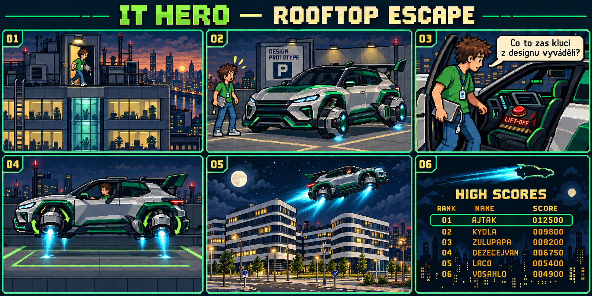

# IT HERO – střešní únik: storyboard, návrh 02



**Stav:** vizuální a režijní návrh ke schválení. Animace zatím není součástí hry.
Po současném vítězství se otevírá funkční tabulka HIGH SCORES se zadáním jména.
Později bude mezi odpojení HDD a tabulku vložena tato sekvence.

## Podoba vozu

Nová Škoda PEAQ jako absurdní sportovní koncept kluků z designu: zachovat velkou
SUV siluetu, dlouhou střechu, ostrou příď, úzká světla a tmavý panoramatický vršek.
Snížený podvozek, rozšířené blatníky, přehnané zadní křídlo, stříbrný lak se
smaragdovými detaily. Bez loga a oficiálních znaků. Kola se překlopí do režimu
antigravitačních trysek. Odlet má filmový elektrický sci-fi charakter; nekopírovat
vzhled Tesly. Obraz je stylizovaný koncept, nikoli přesná reprodukce sériového vozu.
Pro finální sprite porovnat s konkrétní aktuální fotografickou referencí PEAQu.

## Záběry – přibližně 19 sekund

| # | Čas | Obraz / akce | Text / zvuk |
|---|---|---|---|
| 01 | 0–3 s | Široký boční pohled na střechu devítipatrové budovy. Otevřou se servisní dveře; ajťák přiběhne, drží odpojený HDD. Kamera mírně odjede. | „ZÁLOHA ZACHRÁNĚNA.“ Klapnutí dveří, vzdálená klimatizace. |
| 02 | 3–6 s | Na parkovacím místě DESIGN PROTOTYPE čeká sportovní PEAQ. Ajťák se zarazí; kamera ukáže velké křídlo a podezřelé kryty kol. | Ajťák: „Co to zas kluci z designu vyváděli?“ Krátká komická pauza. |
| 03 | 6–9 s | U dveří vozu, potom detail kokpitu. Položí HDD na sedadlo spolujezdce, zapne pás. Na displeji svítí NEPOUŽÍVAT PŘED HOMOLOGACÍ a velké tlačítko LETOVÝ REŽIM. | Ajťák: „Hlavně ať to nechce aktualizaci.“ Cvaknutí pásu. |
| 04 | 9–12 s | Boční celkový záběr. Stisk tlačítka. Auto se zvedne z podvozku, kola se pomalu otočí do horizontální polohy; objeví se modrozelený tah. | Palubní systém: „Schváleno vedením. Fyzikou zatím ne.“ Stoupající elektrický tón. |
| 05 | 12–16 s | Vůz vzlétne ze střechy a obloukem odletí do města. V dolní polovině je rozpoznatelný Laurin & Klement kampus v Mladé Boleslavi podle nové fotografie: nestejně vysoké propojené bloky, zaoblené rohy, bílé vodorovné pásy a tmavé průběžné prosklení. Šála páry z klimatizace zůstane na střeše. | Ajťák: „Tak hlavně žádná porada za letu.“ Krátká vítězná chiptune fanfára. |
| 06 | 16–19 s | Silueta auta proletí za nápisem MISSION COMPLETE. Střih do arkádové tabulky, skóre se dopočítá a rozsvítí se pole pro jméno. | „HIGH SCORES“ / „TVOJE JMÉNO“. Dva arkádové tóny, bez automatického restartu. |

Obrázek zachycuje kompozici, nikoli přesné titulky nebo definitivní sprity.
Hlášky a časování výše jsou zdrojem pro následnou implementaci.

## Realizace v další verzi

- Samostatná Phaser scéna; bez nového fyzikálního souboje a bez možnosti ztratit život.
- Vítězství a finální skóre se potvrdí již při odpojení HDD. Sekvence nesmí
  přičítat bonus znovu. Po dohrání otevře `ITHeroScores.open()` právě jednou.
- Nové lokální textury: střecha, dveře, vůz boční, vůz letící, čtyři překlápěcí
  fáze kol, trysky, kokpit a pózy nastupování hrdiny. Ostré pixely, společná paleta.
- Titulky v bezpečném středu; respektovat ztlumení hry. Enter / mezerník / klepnutí
  na viditelné PŘESKOČIT okamžitě přejde do stejné tabulky skóre.
- Při přepnutí aplikace pozastavit animaci. Mobilní ovladače během sekvence
  deaktivovat. Podporovat zkrácenou variantu při omezení animací v systému.

## Tabulka v této verzi

`score-table.js`: top 10 podle sestupného skóre, jméno do 12 znaků (čeština
povolena), jeden zápis za dokončení. `localStorage` klíč `it-hero-high-scores-v1`.
Bez zadání jména se použije AJŤÁK. HRÁT ZNOVU dovolí odejít i bez uložení.
Jde o lokální výsledky v jednom prohlížeči, nikoli společný internetový žebříček.
Při nepovoleném úložišti se hra nezastaví a tabulka upozorní na dočasné uložení.


## Ověření

Při běžícím lokálním serveru na portu 8000:

```
node tests/score-table.cjs
node tests/gameplay.cjs
node tests/thumb-controls.cjs
node tests/browser.cjs
```

Test výsledků ověřuje finální skóre, české jméno a skutečné psaní mezery i
herních kláves, potvrzení Enterem, ochranu proti dvojímu zápisu, řazení a limit
10 záznamů, načtení po obnovení stránky, výsledek mimo top 10, nepřístupné
úložiště a restart. Kontroluje mobilní rozměry 844×390, 568×320, 390×844 a
320×568. Jde o emulaci v prohlížeči; systémová klávesnice fyzického telefonu
zde ověřená nebyla. Testy hry procházejí skutečné odpojení HDD a novou
výsledkovou obrazovku před restartem.


## Revize 02 – kampus a ukázková jména

Pátý záběr nově používá architekturu Laurin & Klement kampusu z dodané fotografie;
ostatní záběry a původní střešní budova zůstávají zachované. Šestý panel je
ilustrační, přesné názvy soupeřů určuje hra v `score-table.js`, nikoli bitmapa.

`demoNames` obsahuje všech 10 zadaných jmen v původním zápisu. `demoRows(score)`
připraví přibližně 90 % až 22,5 % hráčova skóre, vždy méně než aktuální vítězný
výsledek. V tabulce mají vlastní označenou sekci pod skutečnými rekordy. Tím
zůstanou všechna jména viditelná i vedle skutečného top 10. Nezabírají místa ve
skutečném pořadí a nikdy se nezapisují do localStorage ani budoucího serveru.
Starší skutečně lepší výsledky se nesnižují.

Návrh centrálního ukládání: [Cloudflare Worker + D1](../shared-scores/README.md).
Zatím jde o připravený postup a schéma databáze; hra běží dál v lokálním režimu.
