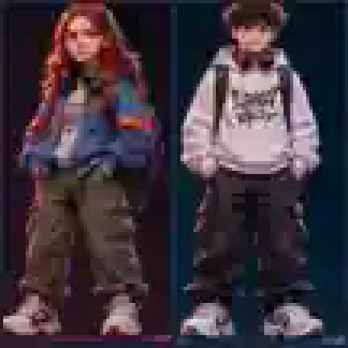

# IT HERO – GEN Z: dvojice dočasných blokátorů / komických NPC

## Úkol
Pracuj v aktuálním repozitáři `LukynovoCZ/IT-HERO` (**ověř poslední HEAD, při zadání byla hra ve verzi 0.13.0**). Implementuj dvě vedlejší postavy **GEN Z – HOLKA a KLUČINA**. Nejde o standardní nepřátele: **neútočí, neubírají životy, nevyžadují porážku**. Náhodně se objevují na jednom patře, krátce hráči překážejí v cestě, komentují situaci a po chvíli odejdou či zmizí.

**Obě varianty musí mít identickou herní logiku, parametry a kolize; mění se jen vzhled, animace a volitelné rozložení hlášek.** Hlavní gag je, že skoro neustále sledují mobil místo okolního dění.

### Grafická reference – je přiložena PŘÍMO V REPOZITÁŘI

[Otevřít obrazovou předlohu](../assets/gen-z-duo-reference.svg) – malý pixelovaný výřez z dříve schváleného konceptu, nikoli finální herní sprite. Vygeneruj nebo ručně připrav výrazně jednodušší **pixel-art**, který ladí s aktuálními postavami, ostré pixely, čisté průhledné pozadí a odpovídající kolizní boxy. Z dodaného obrázku **nevkládej celé pozadí a nepoužívej jej jako hotovou texturu bez vyčištění**.

### 1. Vzhled – přesně dvě postavy

**GEN Z HOLKA**: přibližně 22letá zrzavá mladá žena se středně dlouhými načervenalými vlasy, výrazem znuděného sebevědomí; vzdálená estetická inspirace atmosférou 80. let / mladistvých seriálových hrdinek, ale **nekopíruj podobu konkrétní postavy ani oblečení ze Stranger Things**. Oversize modrá mikina či bunda přes tričko, volné tmavé cargo kalhoty, výrazné tenisky; batůžek, sluchátka na krku a **mobil v ruce**.

**GEN Z KLUK**: přibližně 22letý štíhlejší kluk s výraznými tmavohnědými kudrnatými vlasy nahoře, krátké strany – typický „brokolicový“ střih. Bílošedá oversize mikina, volné černé cargo kalhoty, bílé tenisky, batoh, velká sluchátka a **mobil, do kterého kouká**. Žádná povinná podobnost s konkrétní skutečnou osobou.

Vytvoř herní snímky obou variant (`idle`, `walk`, `stop`, `phone-scroll`, `look-up`, `shrug`, `leave`). Při zastavení malý pohyb palce po displeji, občas vzhlédnutí a pohled zpět na telefon. Při chůzi mohou sledovat mobil, ale animace musí být herně čitelná. Stejná výsledná sprite výška a ukotvení bot, levé/pravé otočení.

### 2. Mechanika – živá překážka
- **Vznik:** náhodná bezpečná poloha v aktuálním patře (u dveří kanceláře, poblíž stolu, případně po straně chodby). Nepřidávej další patra ani nezasahuj do designu map.
- **Příchod:** krátce přijde zpoza objektu nebo se přiblíží ke středu koridoru. **Ujisti se, že se nevytvoří přímo v hráči nebo v pevné překážce**.
- **Blokování:** zastaví se, kouká do mobilu a během cca **5–8 sekund** dočasně zabere prostor jako kolizní překážka pro hlavního hráče. Hráč může postavu bezpečně **přeskočit** nebo počkat; samotný boční dotyk nikdy neubírá energii, nesráží hráče ani ho nezabije.
- **Střelba:** žádná zbraň hráče těmto postavám neubližuje; preferuj, aby projektily **prošly skrz** a neztratily se. Rozhodně je nezařazuj mezi nepřátele do jejich HP či skórování.
- **Odchod:** po náhodné hlášce odejdou, vrátí se za dveře nebo krátce vyblednou. Zabránit duplicity či trvalé kolizi po zmizení.
- **Jedna aktivní postava maximálně** (stejný spawn systém pro obě varianty; varianty volit náhodně, pokud to jde vyváženě 50/50). Umožni snadno nastavit dobu mezi výskyty cca 25–45 sekund aktivního hraní. Pozastavená hra, menu a loading nesmí dál tikat.
- Nesmějí se objevit před výstupními dveřmi, přímou výtahovou interakcí, checkpointem, v zákrytu jiného NPC či na konci slepé chodby, odkud nejde bez poškození odejít. Nevytvářej soft-lock během soubojů s bossy.
- **DŮLEŽITÉ:** uživatel zmínil existující **náhodné zarážky**. Nejprve zjisti, jaké objekty jsou tím v aktuální verzi míněné. Nahraď pouze odpovídající **dočasné náhodné překážky** těmito NPC. **Neodstraňuj** pevné kancelářské stoly, servisní lávky, schody, úkolové prvky, pohyblivé vozíky, zábrany s důležitou logikou, `old-badger` ani `DEMAND` jiných nepřátel. Pokud nelze žádnou bezpečně identifikovat, použij vlastní spawn systém a výměnu starých překážek odlož do PR poznámky.
- Implementuj v rámci existující Phaser Arcade Physics architektury, žádné nové závislosti, nerozbij web na mobilu.

### 3. Hlášky – krátké české bubliny, náhodně podle kontextu

**Když blokují cestu:**
- „Tak já snad uhýbat nebudu!“
- „V klídku, jdu si jenom pro kafe.“
- „Sorry, nemám sociální baterku.“
- „Já jen scrolluju.“
- „Jasný, úplně v pohodě.“

**O generacích, práci a home office:**
- „Už jsem v práci tři hodiny, tak snad už bych měl jít domů.“
- „Pět dní home officeu v týdnu je snad samozřejmost.“
- „A tobě je čtyřicet a ještě žiješ?“
- „Jasný, mám depresi.“
- „Teď už mi je tři… ne, šestnáct… kecám, dvacet dva.“
- „Dneska už mám splněno. Byl jsem online.“

**Gen Z slang / náhodné:**
- „Six, seven!“
- „To je trochu skibidi.“
- „Tohle je lepší než real life.“
- „No cap.“
- „Lowkey to nedává smysl.“
- „To je mega cringe.“
- „Main character energy.“
- „To je vibe.“
- „Fr fr.“

Texty ponech v přirozené češtině a u výslovných uživatelských vět zachovej znění. Časem se budou měnit; přidej je do současného `character-dialogue.js` nebo dedikované přehledné datové struktury. Zabránit opakovanému spamování textu, u dlouhých vět zalomit do 2–3 řádků a posunout bublinu do viditelné části scény. Obě postavy sdílejí stejné hlášky; jen volba může být náhodná.

### 4. Technická implementace
Ověř související části:
- `game.js` (ve verzi 0.13.0: 9 pater, `FLOOR_PLANS`, `this.obstacles`, `this.enemies`, kolize a přechody);
- `gameplay.js` (pohyblivé vozíky a speciální trasy – **nenahrazovat naslepo**);
- `character-dialogue.js` (centrální hlášky);
- `old-badger.js` (nezávislá postava s jinými pravidly);
- `enemy-catalog.js` (NPC nezařazuj mezi skutečné nepřátele).
Doporučený modul `gen-z-blockers.js`; připoj jej v `index.html` ve správném pořadí, ideálně integruj přes lifecycle hooks, ne velkým přepisem `game.js`.
Parametry konfigurovatelně na jednom místě: `spawnDelayMin/Max`, `blockingDurationMin/Max`, `walkSpeed`, `maxActive=1`, `collisionWidth/Height`, `minDistanceFromPlayer`, `doorSafeRadius`, `dialogueCooldown`. Nepřidávej nové externí runtime API.

### 5. Akceptace
1. Start z `index.html` bez chyb a fungující Enter/kliknutí.
2. Obě varianty se náhodně střídají, jsou graficky rozeznatelné a drží mobil.
3. Vystoupí/přijdou, zastaví se, „scrollují“, řeknou hlášku a po 5–8 s odejdou.
4. Během zastavení blokují chůzi, ale hráč je může bezpečně přeskočit či počkat.
5. Nedochází ke ztrátě zdraví, zasažení vlastním projektilem nebo skórování jejich porážek.
6. Nikdy neblokují schodiště/cíl nebo checkpoint tak, aby byl postup nemožný.
7. Restart/přechod mezi patry/pauza/game over uklidí časovače, bubliny a kolize.
8. Dosavadní bossové, Starý Jezevec, IT kolega, kávy, plakáty, mobilní ovládání a progres zůstávají funkční.
9. Ujisti se, že náhodné zarážky se nenahradí odstraněním důležitých mechanik.

### Výstup
- Proveď úpravy v samostatné větvi `feature/gen-z-blockers`.
- Připrav pull request do `main`, **bez automatického merge**.
- V PR ukaž screenshot nebo krátkou demonstraci obou variant ve hře a výsledek testů.
- Pokud browser testování není možné, řekni to explicitně, netvrď, že jsi ho provedl.
- Uveď, kde lze změnit vzhled, načasování a hlášky.

---
Úkol na GitHubu: https://github.com/LukynovoCZ/IT-HERO/issues/2
